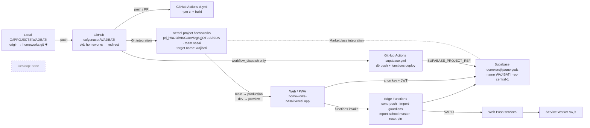

# WAJIBATI — Integration Map

Legend: **[V]** verified in this audit · **[R]** from repo files (config/docs), not live-checked · **[A]** assumption

✱ local remote URL still points to the old name — works via redirect; update per audit §8.1.

## Links

| # | From → To | Mechanism | Identity / key | Status |
|---|---|---|---|---|
| 1 | Local → GitHub | `origin` HTTPS | `https://github.com/sufyanaser/homeworks.git` (old) | **[V]** redirects to `WAJIBATI` — identical refs |
| 2 | GitHub → Actions CI | `on: push, pull_request` | repo-relative checkout | **[R]** `ci.yml`; build uses `secrets.VITE_*` or placeholders |
| 3 | GitHub → Actions Supabase deploy | `workflow_dispatch` | secrets `SUPABASE_ACCESS_TOKEN`, `SUPABASE_DB_PASSWORD`, `SUPABASE_PROJECT_REF` | **[R]** manual only; secrets survive repo rename **[A]** |
| 4 | GitHub → Vercel | Vercel Git integration | GitHub repo numeric ID | **[R]** documented; post-rename link **NOT VERIFIED** (Vercel API 403 for `nasai`) |
| 5 | Vercel → Web/PWA | build `tsc -b && vite build`, `vercel.json` SPA rewrites + `sw.js` no-cache | project `homeworks` / ID `prj_h5aJ…39DA` | **[R]** `main`→prod, `dev`→preview |
| 6 | Vercel ↔ Supabase | Vercel Marketplace integration | Supabase org `vercel_icfg_EKF0YIvMZtgJPitMvhlxCrHr` | **[V]** from `supabase/.temp/linked-project.json`; bound to project ID, not name **[A]** |
| 7 | Vercel env → client | `VITE_SUPABASE_URL`, `VITE_SUPABASE_ANON_KEY`, `VITE_VAPID_PUBLIC_KEY` | — | **[R]** values not inspected |
| 8 | Web/PWA → Supabase | supabase-js, email/password auth | `<digits>@guardian.rumaila.local`, `<user>@admin.rumaila.local` | **[V]** code; no redirect URLs used |
| 9 | Web/PWA → Edge Functions | `supabase.functions.invoke` with user JWT | CORS `*` | **[V]** code |
| 10 | Edge Functions → Supabase | service role (server-side only) | built-in `SUPABASE_*` secrets | **[V]** code; never in client bundle |
| 11 | `send-push` → Web Push → SW | VAPID | `VAPID_SUBJECT=mailto:sufyanaser@gmail.com` | **[V]** code; notification title now `واجباتي` |
| 12 | PWA install identity | manifest `start_url: /`, `scope: /`, origin | **origin = `homeworks-nasai.vercel.app`** | **[V]** manifest; origin change ⇒ reinstall + resubscribe |
| 13 | Desktop | — | — | **[V]** no Electron/desktop app exists; `Wajibati Admin` reserved for future use |
| 14 | OIDC trust | — | Vercel OIDC `sub` contains project name | **[V]** none used in repo; external policies **NOT VERIFIED** |

## Rename impact by layer

| Layer | Rename-safe? | Note |
|---|---|---|
| GitHub | Done | Redirect active; update local remote |
| Actions | Yes | No repo-name coupling |
| Vercel | Conditional | Name change alters default URLs + OIDC `sub`; keep old production alias |
| Supabase | N/A | Ref immutable; display name already `WAJIBATI` |
| Web/PWA | Yes (code) | Origin must stay stable for installed PWAs and push subscriptions |
| Desktop | N/A | Not present |
