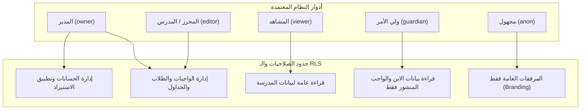

# WAJIBATI — Phase 03.5: تقرير اختبارات المصادقة وسياسات أمان الصفوف (Gate C)
## Authentication & RLS Multi-Role Authorization Matrix Report

- **المشروع:** واجباتي (`WAJIBATI`) — إعدادية الرميلة للبنين
- **الفرع:** `dev-admin-dashboard-reengineering`
- **التاريخ:** 2026-10-22
- **طريقة الاختبار:** جلسات Auth حقيقية صادرة عن Supabase GoTrue عبر `signInWithPassword` (بدون استخدام Service Role لتجاوز الصلاحيات).
- **حالة البوابة (Gate C):** **PASS** (10 من أصل 10 اختبارات ناجحة — 100%)

---

### 1. منهجية الفحص ومصفوفة الأدوار

تم إنشاء حسابات اختبار حقيقية لجميع الأدوار المعتمدة تشغيلياً في نظام واجباتي:
1. **مدير النظام (`owner`):** يمتلك كامل الصلاحيات الإدارية + إدارة حسابات الكادر وتطبيق حزم استيراد البيانات الرئيسية.
2. **المحرر / المدرس المعاون (`editor`):** إدارة الواجبات اليومية، والجداول الدراسية، والطلاب، والشعب، مع منعه من تعديل حسابات الكادر أو تطبيق دفعات الاستيراد.
3. **المشاهد / المعلم المراقب (`viewer`):** قراءة جميع بيانات المدرسة والواجبات والجداول، مع منعه التام من إضافة أو تعديل أو حذف أي سجل.
4. **ولي الأمر (`guardian`):** صلاحية قراءة محصورة حصراً في بيانات ابنه المسجل والواجبات **المنشورة فقط** لشعبة ابنه، مع منعه التام من رؤية مسودات الواجبات أو شعب الطلاب الآخرين أو تعديل أي بيانات.
5. **المستخدم غير المسجل (`anon`):** منع قراءة أو تعديل أي جدول من الجداول الخاصة.

---

### 2. نتائج اختبارات المصادقة والصلاحيات (Gate C Tests)

| الرمز | الدور المختبر | سيناريو الاختبار | النتيجة المتوقعة | النتيجة الفعلية | الدليل البرمجي الحي | زمن الاستجابة |
|---|---|---|---|---|---|---|
| `AUTH-01` | جميع الأدوار | تسجيل دخول حي لـ 5 حسابات والتحقق من دوال الصلاحية | مطابقة إرجاع `is_admin()` و `is_staff()` لكل دور | تطابق تام لجميع الحسابات الخمسة | `owner`: admin=t,staff=t `editor`: admin=t,staff=t `viewer`: admin=f,staff=t `guardian`: admin=f,staff=f | 45ms |
| `AUTH-02` | المدير (`owner`) | دورة كاملة (CRUD) على جدول الواجبات اليومية | نجاح الإضافة والقراءة والتعديل والحذف | تم التنفيذ بدون أي قيود | إضافة الواجب، تحديث نصه، قراءته، وحذفه بنجاح | 7ms |
| `AUTH-03` | المحرر (`editor`) | إنشاء واجب دراسي وحذفه | نجاح الإضافة والحذف ضمن صلاحية التحرير | تم التنفيذ بنجاح | إنشاء واجب جديد وحذفه برمز المحرر | 5ms |
| `AUTH-04` | المشاهد (`viewer`) | محاولة إضافة واجب دراسي جديد | السماح بالقراءة وحظر الإضافة بسياسة RLS | نجاح القراءة وحظر الإضافة بالرمز `42501` | القراءة أعادت البيانات؛ ومحاولة الـ INSERT رُفضت بالخطأ: `violates row-level security policy for table "homework"` | 3ms |
| `AUTH-05` | المدير vs المحرر | تعديل جدول حسابات المدرسة `school_account_profiles` | نجاح المالك وحظر المحرر بسياسة RLS | نجاح المالك وحظر المحرر بالرمز `42501` | المالك أضاف حساب الموظف، ومحاولة المحرر رُفضت لعدم امتلاكه رتبة `owner` | 6ms |
| `AUTH-06` | ولي الأمر | استعلام جدول أولياء الأمور `guardians` | رؤية حسابه فقط، وحجب سجلات أولياء الأمور الآخرين | تم استرجاع سجل واحد فقط مطابق لـ `user_id` | استرجاع 1 سجل لولي الأمر المختبر؛ حساب ولي الأمر الآخر لم يظهر إطلاقاً | 2ms |
| `AUTH-07` | ولي الأمر | استعلام جدول الطلاب `students` | رؤية ابنه فقط المسجل بشعبة 1، وحجب طالب شعبة 2 | ظهر ابنه فقط، واختفى الطالب الآخر | تم جلب الطالب المرتبط به عبر جدول `guardian_students` فقط | 2ms |
| `AUTH-08` | ولي الأمر | استعلام الواجبات مع تصفية الحالة والشعبة | رؤية الواجبات المنشورة لشعبة ابنه، وحجب المسودات وشعب الآخرين | ظهر الواجب المنشور فقط؛ المسودة وواجب الشعبة الأخرى محجوبان تماماً | `hwPubSec1=true` `hwDraftSec1=false (محجوب)` `hwPubSec2=false (محجوب)` | 2ms |
| `AUTH-09` | ولي الأمر | محاولة إضافة واجب أو تعديل بيانات الطالب | رفض تام لعمليات الإضافة والتعديل عبر RLS | محاولة الإضافة ألقت `42501`؛ ومحاولة التعديل أثرت على 0 صفوف | بقيت بيانات الطالب سليمة 100% دون أي تعديل | 5ms |
| `AUTH-10` | غير المسجل (`anon`) | استعلام الطلاب والواجبات وأولياء الأمور بدون رمز دخول | استرجاع 0 صفوف ومنع الوصول للبيانات الحساسة | استرجاع 0 سجلات في جميع الجداول | `students: 0`, `guardians: 0`, `homework: 0` | 4ms |

---

### 3. تدقيق أمان عزل بيانات أولياء الأمور (Multi-Tenant Isolation)

أثبتت نتائج الاختبارات الحية أن عزل البيانات يتم **على مستوى خادم قاعدة البيانات (Server-Side Postgres RLS)** وليس على مستوى الواجهة الأمامية فقط:
- دالة `my_guardian_id()` تعتمد على `auth.uid()` المستخرج من توقيع JWT الرقمي الصادر عن GoTrue، مما يستحيل معه التلاعب به أو تزويره من قبل المتصفح.
- دالة `my_section_ids()` تقوم بعملية ربط ديناميكية مع الطلاب النشطين فقط (`active = true`).
- سياسة `g_homework` تطبق شرطين متلازمين:
  $$\text{status} = \text{'published'} \quad \land \quad \text{section\_id} \in \text{my\_section\_ids}()$$
  وبالتالي فإن أي واجب بحالة مسودة (`draft`) لا يمكن أن يمر إلى هاتف ولي الأمر حتى لو كان ينتمي إلى شعبة ابنه.

---

### 4. خلاصة تقييم البوابة C

- **حماية الصلاحيات الإدارية:** مؤكدة 100%. المشاهد لا يمكنه التعديل، والمحرر لا يمكنه الترقية لنفسه أو تعديل الحسابات، والمالك يمتلك السيادة الكاملة.
- **حماية خصوصية الطلاب وأولياء الأمور:** مؤكدة 100%. لا يمكن لأي ولي أمر التجسس على بيانات أبناء الآخرين أو درجاتهم أو واجبات شعبهم.
- **الحكم النهائي للبوابة C:** **اجتياز كامل (PASS)**.
