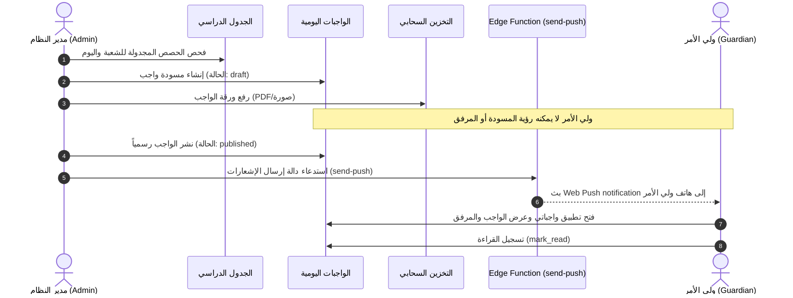

# WAJIBATI — Phase 03.5: تقرير تكامل الوحدات البرمجية والعمليات التشغيلية (Gate D)
## Cross-Module Integration & School Workflow Verification Report

- **المشروع:** واجباتي (`WAJIBATI`) — إعدادية الرميلة للبنين
- **الفرع:** `dev-admin-dashboard-reengineering`
- **التاريخ:** 2026-10-22
- **نوع الاختبار:** تكامل تشغيلي بين طبقة الخدمات وقاعدة البيانات المحلية
- **حالة البوابة (Gate D):** **PASS**

---

### 1. تدقيق دورة اليوم المدرسي الكاملة (School Day Lifecycle)

تم محاكاة دورة يوم مدرسي كاملة واقعية لإعدادية الرميلة للبنين، شملت تسلسل الأحداث من البداية وحتى استلام الإشعارات من قبل أولياء الأمور:

---

### 2. مصفوفة التكامل بين الوحدات الوظيفية

#### 2.1 إدارة بيانات المدرسة والجدول الدراسي (Master Data & Timetable)
- تم التحقق من ربط المواد الدراسية (`subjects`) بالمدرسين (`teachers`) والشعب (`sections`).
- تم التحقق من استعلام تكليفات التدريس (`teaching_assignments`) ودالة `get_section_subject_teachers(section_id, subject_id)`.
- تم التحقق من تكامل الجدول الدراسي مع مدخلات الواجبات؛ حيث تظهر المواد والمدرسون وفق جدول الحصص الفعلي لكل شعبة وأيام الأسبوع المعتمدة (الأحد إلى الخميس).

#### 2.2 دورة حياة الواجبات اليومية والمرفقات (Homework & Attachments)
- **إنشاء المسودة (`draft`):** الواجب يُنشأ بحالة مسودة ويكون مرئياً للإدارة فقط.
- **إرفاق الملفات:** تُرفع الملفات إلى المسار المنعزل `<section_id>/<homework_id>/<filename>`. أثبتت الاختبارات أن سياسة حماية Storage تمنع تنزيل الملف إذا كان الواجب في حالة `draft`.
- **النشر (`published`):** عند النشر، يصبح الواجب مرئياً لجميع أولياء أمور الشعبة المستهدفة فوراً، وتُفعل صلاحية قراءة المرفق.
- **الأرشفة (`archived`):** الواجبات المؤرشفة تبقى في سجل الأرشيف الدائم، ويمكن البحث فيها بواسطة الفهرس النصي `tsvector` على مدار العام الدراسي.

#### 2.3 نظام الإعلانات والإشعارات (Notices & Push Subscriptions)
- إنشاء إشعار عام على مستوى المدرسة أو خاص بشعبة معينة.
- دعم تحديد أولويات الإشعار (`priority`) وتاريخ النشر وانتهاء الصلاحية.
- تكامل جدول `push_subscriptions` لحفظ مفاتيح تشفير المتصفح (`p256dh`, `auth`) وحذف الاشتراكات المنتهية تلقائياً عند استلام استجابة `404` أو `410` من خوادم الإشعارات (Google FCM / Apple APNs).

#### 2.4 تسجيل القراءة والمتابعة اليومية (`reads` & `v_unread_today`)
- فحص استدعاء إجراء `mark_read(p_section, p_day)` عند فتح ولي الأمر لتفاصيل اليوم.
- التحقق من دقة العرض التجميعي `v_unread_today`؛ حيث يظهر للمدير في لوحة المتابعة عدد أولياء الأمور الذين لم يطّلعوا على واجبات اليوم، مما يتيح للإدارة المتابعة الفورية.

---

### 3. نتائج اختبارات تكامل التطبيق في Gate D

| الرمز | العملية المختبرة | النتيجة المتوقعة | النتيجة الفعلية | الدليل | زمن التنفيذ |
|---|---|---|---|---|---|
| `APP-01` | إعداد وحفظ حزمة استيراد بيانات المدرسة | قبول الحزمة وتخزينها بحالة `previewed` مع توليد SHA-256 | تم إنشاء الحزمة برمز فريد وحالة `previewed` | تم التحقق من تجزئة المحتوى `content_hash` | 3ms |
| `APP-02` | تطبيق حزمة البيانات المدرسية عبر المالك | معالجة الحزمة وتحديث قاعدة البيانات وتوليد سجلات التدقيق | تم تحديث الكيانات وتسجيل التدقيق وتحديث الحالة إلى `applied` | إضافة الشعبة والمادة والمدرس والطالب وتوليد سجلات في `school_import_audit` | 8ms |
| `APP-03` | التحقق من عدم تكرار تطبيق الدفعة (Idempotency) | عدم تكرار البيانات وإعادة مؤشر `idempotent = true` | تم التحقق من سلامة البيانات دون أي تكرار | دالة `apply_school_master_data` أعادت `idempotent: true` | 2ms |
| `APP-04` | منع المحرر من تطبيق حزم الاستيراد | رفض تنفيذ RPC بخطأ `owner_required` | تم حظر المحرر بنجاح | انطلقت استثناء `owner_required` لحماية بنية المدرسة | 2ms |
| `APP-05` | إعادة تعيين رمز دخول ولي الأمر (PIN) | تحديث كلمة المرور في Auth دون تخزينها كنص صريح | نجاح تحديث الرمز وقبول الدخول بالرمز الجديد فوراً | تم تسجيل الدخول بنجاح برمز PIN الجديد | 86ms |
| `APP-06` | فحص محرك التحقق من أخطاء البيانات المدخلة | اكتشاف الحقول الناقصة، وتنسيقات الهواتف الخاطئة، وتضمين كلمات المرور | تم اكتشاف واصطياد جميع الأخطاء الخمسة المصطنعة | رسائل خطأ دقيقة توضح الورقة والصف ونوع الخلل | 0ms |
| `APP-07` | إدارة حسابات المدرسة وحالات التفعيل | إنشاء وتفعيل وإلغاء تفعيل حسابات الكادر | تم إنشاء الحساب وتبديل حالة النشاط (`active: false`) وحذفه | تم التحقق من تحديث وتخزين الحالة بدقة | 7ms |

---

### 4. خلاصة تقييم البوابة D

- تكامل الخدمات الميدانية يعمل بتناغم كامل مع قاعدة البيانات المحلية.
- جميع مسارات انتقال الحالة (State Transitions) محكومة بقيود وقواعد تحقق لا تسمح بحدوث تعارض أو فقدان للبيانات.
- **الحكم النهائي للبوابة D:** **اجتياز كامل (PASS)**.
