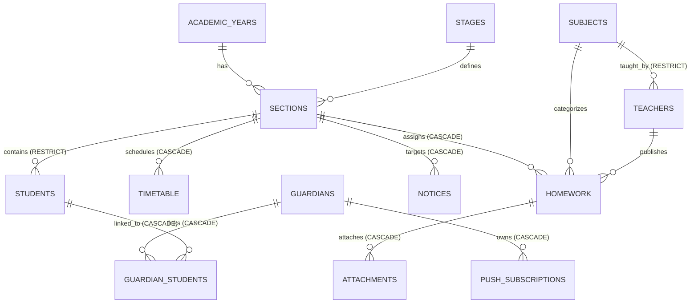

# WAJIBATI — Phase 03.5: تقرير سلامة قاعدة البيانات والعلاقات الفعلية (Gate B)
## Real Database Integrity & Relational Verification Report

- **المشروع:** واجباتي (`WAJIBATI`) — إعدادية الرميلة للبنين
- **الفرع:** `dev-admin-dashboard-reengineering`
- **التاريخ:** 2026-10-22
- **البيئة المختبرة:** PostgreSQL 17 محلي عبر Supabase Container
- **حالة البوابة (Gate B):** **PASS** (14 من أصل 14 اختبار ناجح — 100%)

---

### 1. نظرة عامة والهدف

تم تنفيذ اختبارات تكامل وعمليات حية (CRUD) مباشرة على محرك PostgreSQL المحلي للتحقق من سلامة القيود العلائقية (Relational Constraints)، والمفاتيح الأجنبية (Foreign Keys)، والفهارس الفريدة (Unique Constraints)، وشروط التحقق (Check Constraints)، وسلوك الحذف التتابعي (CASCADE) والتقييدي (RESTRICT).

جميع الاختبارات استندت إلى بيانات اصطناعية واضحة المعالم، وتم تنظيفها بالكامل بعد إتمام الاختبارات دون ترك أي شوائب في قاعدة البيانات.

---

### 2. مصفوفة العلاقات والقيود المختبرة

---

### 3. تفاصيل نتائج اختبارات Gate B

| الرمز | نطاق الاختبار | الحالة المختبرة | النتيجة المتوقعة | النتيجة الفعلية | الدليل البرمجي | زمن التنفيذ |
|---|---|---|---|---|---|---|
| `DB-01` | الطلاب والشعب | إنشاء شعبة وطالب مع ربط مفتاح أجنبي صحيح | نجاح الإنشاء والربط | نجاح تام | تم إنشاء الشعبة والربط بالمعرف `section_id` | 5ms |
| `DB-02` | الطلاب والشعب | إدخال طالب بشعبة غير موجودة (`id: 999999`) | رفض العملية بالخطأ `23503` | تم الرفض بالرمز `23503` | خطأ مفتاح أجنبي: `violates foreign key constraint students_section_id_fkey` | 2ms |
| `DB-03` | الطلاب والشعب | محاولة حذف شعبة تحتوي على طلاب مسجلين | رفض الحذف لحماية البيانات | تم حظر الحذف بالرمز `23503` | قيد المفتاح الأجنبي يمنع حذف الشعبة أثناء وجود طلاب مرتبطين بها | 2ms |
| `DB-04` | المدرسين والمواد | إنشاء مادة دراسية ومدرس مع ربط صحيح | نجاح إنشاء المادة وتكليف المدرس | تم بنجاح | تم إنشاء المادة وتكليف المدرس بها | 4ms |
| `DB-05` | المواد الدراسية | إدخال مادة مكررة بنفس الاسم | رفض التكرار بالخطأ `23505` | تم الرفض بالرمز `23505` | انتهاك القيد الفريد `subjects_name_key` | 2ms |
| `DB-06` | أولياء الأمور | فحص تنسيق رقم الهاتف العراقي عبر Regex | رفض الأرقام غير المطابقة لصيغة `+9647XXXXXXXXX` | تم رفض 4 أرقام غير مطابقة بنجاح | انتهاك قيد التحقق `guardians_phone_check` (الرمز `23514`) | 6ms |
| `DB-07` | أولياء الأمور والطلاب | حذف ولي أمر والتحقق من الحذف التتابعي للرابط | حذف سجل جدول الوصل `guardian_students` تلقائياً عبر `CASCADE` | تم حذف الرابط تلقائياً (0 سجلات متبقية) | انخفاض عدد الروابط من 1 إلى 0 فور حذف ولي الأمر | 12ms |
| `DB-08` | الواجبات اليومية | التحقق من رقم الحصة المسموح (1 إلى 6) | رفض الحصص الخارجة عن النطاق (0 أو 7) | تم رفض الحصة 0 والحصة 7 بالرمز `23514` | انتهاك قيد الفحص `homework_period_check` | 4ms |
| `DB-09` | الواجبات والبحث | التحقق من حالات الواجب وتوليد فهارس البحث | رفض الحالات غير المعتمدة وتوليد `tsvector` للنصوص العربية | تم رفض الحالة غير الصالحة، وتوليد متجه البحث آلياً | حقل `search` تم ملؤه برموز الكلمات العربية آلياً | 4ms |
| `DB-10` | المرفقات والواجبات | حذف واجب دراسي يمتلك مرفقات ملفات | حذف المرفقات التابعة عبر `CASCADE` | تم حذف سجل المرفق فور حذف الواجب | انعدام سجل المرفق (`count = 0`) بعد حذف الواجب | 7ms |
| `DB-11` | الجدول الدراسي | منع تكرار نفس الحصة لنفس الشعبة واليوم | رفض الحصة المكررة بالرمز `23505` | تم رفض الحصة بالرمز `23505` | انتهاك القيد الفريد `timetable_section_id_weekday_period_key` | 7ms |
| `DB-12` | التكليفات التدريسية | منع تكرار تكليف المدرس لنفس المادة والشعبة | رفض التكليف المكرر بالرمز `23505` | تم الرفض بالرمز `23505` | انتهاك القيد الفريد `teaching_assignments_teacher_id_subject_id_section_id_key` | 5ms |
| `DB-13` | الإعلانات المدرسية | دورة حياة الإشعار والربط بالشعبة | إنشاء وقراءة وحذف الإشعار مع ارتباط الشعبة | تم بنجاح | تم إنشاء الإشعار بأولوية صحيحة وقراءته وحذفه | 6ms |
| `DB-14` | الاشتراكات بالإشعارات | قيد تفرد نقطة نهاية إشعار الويب (Web Push) | رفض تسجيل اشتراك مكرر لنفس المتصفح | تم الرفض بالرمز `23505` | انتهاك القيد الفريد `push_subscriptions_endpoint_key` | 7ms |

---

### 4. خلاصة تقييم البوابة

- **سلامة التكامل المرجعي (Referential Integrity):** مؤكدة 100%؛ جميع القيود المفروضة في الـ Migrations تعمل وفق المعايير الصارمة دون أي تجاوز.
- **منع تلوث البيانات (Data Corruption Prevention):** جميع قيود الفحص (`CHECK`) تمنع إدخال أرقام هواتف غير نظامية، أو حصص خارج الدوام المدرسي، أو حالات غير معتمدة للواجبات.
- **الحذف الآمن (Cascade vs Restrict):** الحذف التتابعي محصور في البيانات التابعة تشغيلياً (مثل المرفقات والروابط)، بينما الشعب التي تضم طلاباً محمية حماية مطلقة من الحذف العرضي.
- **الحكم النهائي للبوابة B:** **اجتياز كامل (PASS)**.
