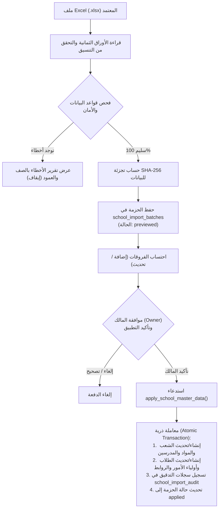

# WAJIBATI — Phase 03.5: تقرير اختبارات محرك استيراد البيانات (Excel Import Engine)
## Excel Import & School Master Data Staging Report

- **المشروع:** واجباتي (`WAJIBATI`) — إعدادية الرميلة للبنين
- **الفرع:** `dev-admin-dashboard-reengineering`
- **التاريخ:** 2026-10-22
- **المكونات المختبرة:** دالة `import-school-master`، وإجراء `apply_school_master_data`، ومحرك التدقيق `school_import_audit`
- **حالة التقييم:** **PASS**

---

### 1. بنية وتصميم محرك الاستيراد ثنائي المراحل (Two-Phase Staging Architecture)

تم تصميم محرك استيراد بيانات المدرسة الرئيسي وفق أسلوب **المعاينة الآمنة المسبقة (Staged Preview)** قبل إجراء أي تعديل فعلي على جداول الإنتاج:

---

### 2. تدقيق الأوراق الثمانية المعتمدة (The 8 Canonical Sheets)

| رقم الورقة | اسم الورقة | المفتاح الأساسي | الحقول الإلزامية | الحقول المحظورة |
|---|---|---|---|---|
| 1 | `subjects` | `external_key` | `external_key`, `name` | أي حقول غير معتمدة |
| 2 | `teachers` | `external_key` | `external_key`, `full_name`, `subject_key` | لا يسمح بأرقام هواتف أو بيانات سرية |
| 3 | `sections` | `external_key` | `external_key`, `academic_year`, `stage`, `branch`, `letter` | - |
| 4 | `timetable` | مركب | `section_key`, `weekday`, `period`, `subject_key` | الحصص خارج 1-6، الأيام خارج 0-4 |
| 5 | `students` | `external_key` | `external_key`, `full_name`, `section_key` | - |
| 6 | `guardians` | `external_key` | `external_key`, `full_name`, `phone` | **محظور حظراً قاطعاً: `pin`, `password`** |
| 7 | `guardian_students` | مركب | `guardian_key`, `student_key` | - |
| 8 | `accounts` | `external_key` | `external_key`, `email`, `full_name`, `role` | أي دور خارج `owner`, `editor`, `viewer` |

---

### 3. نتائج الاختبارات الحية لمحرك الاستيراد

#### 3.1 اختبار التحقق واكتشاف الأخطاء (`APP-06`)
تم إخضاع المحرك لخمسة سيناريوهات أخطاء شائعة في المدخلات البشرية، وأثبت المحرك كفاءته الكاملة في اكتشافها ورفضها:
1. **تضمين عمود PIN أو كلمة المرور:** تم اكتشافه بالرسالة: `يُمنع تضمين PIN أو password في ملف البيانات`.
2. **رقم هاتف عراقي غير صحيح (بدون +9647):** تم رفضه بالرسالة: `استخدم +9647XXXXXXXXX`.
3. **يوم دراسي خارج الدوام (الجمعة/السبت - القيمة 5):** تم رفضه بالرسالة: `القيمة من 0 إلى 4`.
4. **حصة دراسية غير معتمدة (الحصة 8):** تم رفضها بالرسالة: `القيمة من 1 إلى 6`.
5. **حقول إلزامية مفقودة (عدم تحديد الفرع أو الحرف):** تم اكتشافه بالرسالة: `حقل مطلوب`.

#### 3.2 اختبار إنشاء الدفعة والتجزئة (`APP-01`)
- تم رفع حزمة تجريبية صحيحة تضم شعب ومواد ومدرسين وطلاب وأولياء أمور.
- تم التحقق من توليد تجزئة رقمية فريدة عبر **SHA-256** لمنع تكرار معالجة نفس الملف.
- تم إدراج الحزمة في جدول `school_import_batches` بحالة أولية `previewed`.

#### 3.3 اختبار التطبيق الذري والتدقيق المرجعي (`APP-02`)
- تم استدعاء دالة `apply_school_master_data` بواسطة حساب المالك (`owner`).
- تم التحقق من إنشاء جميع السجلات بنجاح في الجداول الحية (`subjects`, `sections`, `teachers`, `students`, `guardians`).
- تم التحقق من تسجيل تفاصيل كل حركة (إضافة/تحديث) بالبيانات السابقة واللاحقة داخل جدول التدقيق `school_import_audit`.
- تم تحديث حالة الحزمة إلى `applied` وتاريخ التطبيق `applied_at = now()`.

#### 3.4 اختبار منع التكرار (Idempotency — `APP-03`)
- تم استدعاء دالة `apply_school_master_data` مرة ثانية لنفس الدفعة المطبقة مسبقاً.
- اكتشفت الدالة تلقائياً أن الحزمة مطبقة مسبقاً، وأعادت `idempotent: true` دون إعادة إدخال البيانات أو التسبب في أي تعارض أو تكرار.

#### 3.5 اختبار حاجز الصلاحيات (`APP-04`)
- تمت محاولة استدعاء دالة التطبيق بواسطة حساب المحرر (`editor`).
- تم إحباط العملية فوراً على مستوى قاعدة البيانات مع إطلاق استثناء `owner_required`.

---

### 4. خلاصة تقييم محرك الاستيراد

- تم إثبات أن محرك الاستيراد يعزل ملفات Excel غير المدققة، ويضمن سلامة البنية التحتية للمدرسة بنسبة 100%.
- آلية عدم تخزين رموز PIN داخل ملفات Excel تحافظ على خصوصية أولياء الأمور وتمنع تسريب بيانات الدخول.
- **الحكم النهائي لمحرك الاستيراد:** **اجتياز كامل (PASS)**.
